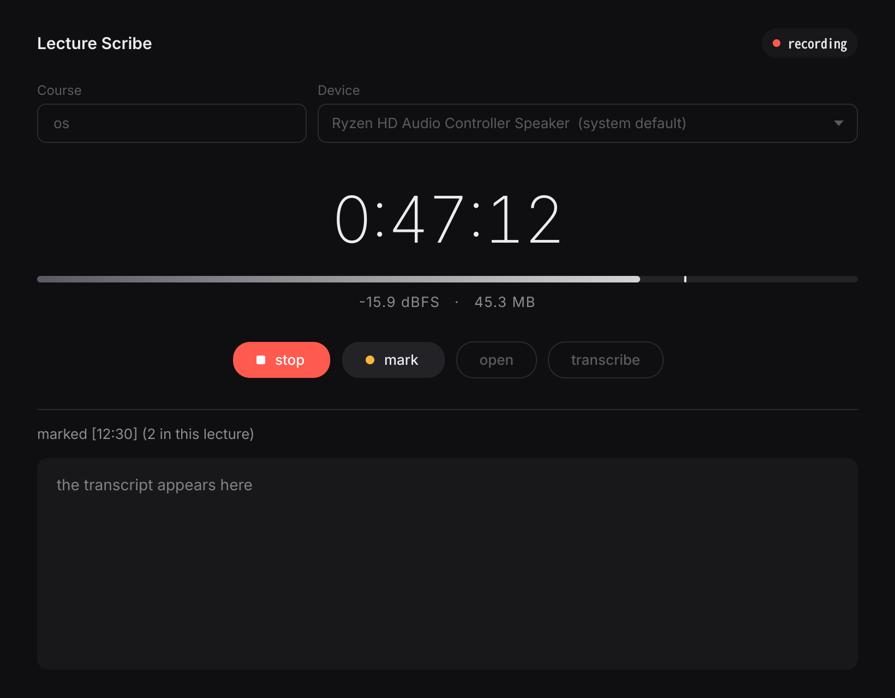
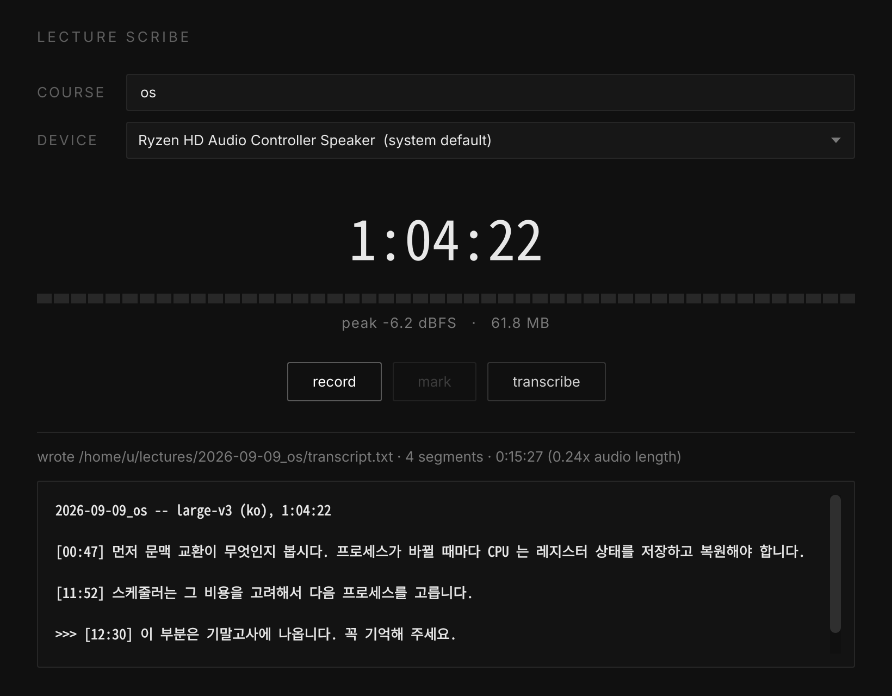

<h1 align="center">
  <picture>
    <source media="(prefers-color-scheme: dark)" srcset="./.github/assets/lecture-scribe-dark.png">
    
  </picture>
</h1>

<p align="center">
  <i>Record the Korean lecture your computer is playing, and read it back as text 🎧</i>
</p>

<p align="center">
  <a href="./LICENSE"></a>
  <a href="./pyproject.toml"></a>
  <a href="#install"></a>
  <a href="#what-it-does"></a>
</p>

<p align="center">
  <a href="#install">Install</a> ·
  <a href="#using-the-window">Using the window</a> ·
  <a href="#what-you-get">What you get</a> ·
  <a href="#faster-with-an-nvidia-card">GPU</a> ·
  <a href="#troubleshooting">Troubleshooting</a> ·
  <a href="#settings">Settings</a>
</p>

<p align="center">
  
</p>

## What it does

Play a lecture in your browser. `lecture-scribe` records what the computer is
playing and turns it into a text file you can read, search and copy from, with
a timecode on every paragraph.

<table>
  <tr>
    <td align="center" width="25%">▶️<br><b>Play</b><br><sub>the lecture, in any app or browser tab</sub></td>
    <td align="center" width="25%">⏺️<br><b>Record</b><br><sub>press record, press <b>mark</b> at the important bits</sub></td>
    <td align="center" width="25%">📝<br><b>Transcribe</b><br><sub>a speech model writes down the Korean</sub></td>
    <td align="center" width="25%">📖<br><b>Read</b><br><sub>a <code>.txt</code> with <code>[MM:SS]</code> timecodes</sub></td>
  </tr>
</table>

- **Records the computer, not the room.** No microphone involved: background
  noise, typing and your own voice stay out of the recording.
- **Made for Korean.** The language is fixed to Korean, which avoids the
  model mistaking the first seconds for Japanese and getting the whole file
  wrong.
- **Readable, not a wall of text.** The text is split into paragraphs, each
  with a timecode, and the moments you marked stand out.
- **Never loses a recording.** Audio is written to disk as it comes in, so
  even a crash keeps everything recorded so far. Recordings are never deleted
  or overwritten by the app.
- **Works offline.** After a one-time model download, nothing leaves your
  computer.

## Install

You need **[uv](https://docs.astral.sh/uv/)**, which brings its own Python, and
about **4 GB of free disk** for the speech model. Choose your system:

<details open>
<summary><b>Windows</b></summary>
<br>

Open **PowerShell** and run:

```powershell
winget install astral-sh.uv
```

Close PowerShell and open a new one so it finds `uv`, then:

```powershell
git clone https://github.com/snowing152/lecture-scribe.git
cd lecture-scribe
uv sync
Copy-Item config.example.toml config.toml
```

> [!TIP]
> No `git`? On the GitHub page press **Code → Download ZIP**, unpack it, and
> `cd` into the unpacked folder instead of the `git clone` line.

> [!NOTE]
> Recording and the Start Menu entry have been used on Windows 11. The newest
> look of the window and the GPU mode have so far only been run on Linux, so
> do a short test run (below) before relying on it for a real lecture.

</details>

<details>
<summary><b>Linux</b></summary>
<br>

```bash
sudo pacman -S uv        # or: curl -LsSf https://astral.sh/uv/install.sh | sh
git clone https://github.com/snowing152/lecture-scribe.git
cd lecture-scribe
uv sync
cp config.example.toml config.toml
```

Recording uses PipeWire or PulseAudio, which every common desktop already has.

</details>

### Check that it works

```bash
uv run scribe doctor
```

This only looks around and writes nothing. It should show:

- a **loopback device**: the speakers or headphones that are playing sound
  right now,
- the **speech model** as `not downloaded`. That is fine, it downloads on
  the first transcription,
- **what keeps the screen awake**: `SetThreadExecutionState` on Windows,
  `org.freedesktop.ScreenSaver` on Linux.

Then do a test run: play any video, start `uv run scribe gui`, record half a
minute, press **stop**, then **transcribe**.

> [!IMPORTANT]
> The first transcription downloads the speech model, about **3 GB**, so give
> it time and an internet connection. After that it works offline.

### Add it to the Start Menu / app menu

So you can open the window without a terminal:

```bash
uv tool install --editable . --force   # puts scribe and scribe-gui on your PATH
scribe launcher                        # run this inside the lecture-scribe folder
```

The window now appears in the Start Menu on Windows, or in the application
launcher on Linux, with its own icon. `scribe launcher --remove` takes it out
again.

> [!WARNING]
> Run `scribe launcher` **from the folder that holds `config.toml`**. The menu
> entry remembers that folder; started from anywhere else, the window would
> run on the default settings and ignore yours.

If PowerShell says `scribe` is not recognised, run `uv tool update-shell` once
and open a new window.

## Using the window

<p align="center">
  
</p>

1. **Start the lecture** playing.
2. **Type a course name** (for example `os`). It names the folder the
   recording goes into.
3. Press **record**. The status chip turns red and says `recording`, and the
   meter shows the sound level.
4. Press **mark** (<kbd>Ctrl</kbd>+<kbd>M</kbd>) whenever something is worth
   finding again, such as "this will be on the exam". Marked paragraphs show
   in amber.
5. Press **stop** when the lecture ends.
6. Press **transcribe**. The meter turns into a progress bar and the text
   appears in the pane as it is recognised, so you can start reading straight
   away.

| button | shortcut | what it does |
|---|---|---|
| **record** / **stop** | | start and finish a recording |
| **mark** | <kbd>Ctrl</kbd>+<kbd>M</kbd> | flag this moment; the paragraph gets `>>>` in the file |
| **transcribe** | | turn the recording into text; becomes **stop** while it runs |
| **open** | <kbd>Ctrl</kbd>+<kbd>O</kbd> | pick an earlier recording, or any WAV file |

Good to know:

- **The PC won't fall asleep or lock** while a recording or a transcription
  runs, so you can walk away from a long lecture. It goes back to normal as
  soon as the work ends.
- **Opening an old recording** shows its transcript if one already exists.
  Press **transcribe** to make a fresh one.
- **Stopping a transcription halfway writes nothing**, because half a lecture
  would look like a whole one. Closing the window during a transcription
  asks you first.
- **Copying**: select all, then copy, and you get the text exactly as it is in
  the `.txt` file.
- Colours mean something: **red** means recording, **amber** means a mark.

## What you get

Each lecture gets its own folder, by default inside `lectures` in your home
folder (`C:\Users\<you>\lectures` on Windows, `~/lectures` on Linux):

```
lectures/2026-09-09_os/
├── 2026-09-09_os.wav   the recording, never deleted by the app
└── 2026-09-09_os.txt   the transcript
```

The transcript looks like this:

```
[00:47] 먼저 문맥 교환이 무엇인지 봅시다. 프로세스가 바뀔 때마다 CPU 는
        레지스터 상태를 저장하고 복원해야 합니다.

>>> [12:30] 이 부분은 기말고사에 나옵니다.
```

- `[00:47]` is where the paragraph starts in the lecture. Past one hour it
  becomes `[1:02:30]`.
- `>>>` marks a moment you flagged with **mark**.
- **Rename the folder** to the lecture's title before transcribing, and the
  transcript gets that name too.
- A second lecture of the same course on the same day goes into
  `2026-09-09_os-2`. Nothing is ever written over an existing recording.

## Faster with an NVIDIA card

Without a graphics card, transcription runs on the processor. It is just as
accurate, but slower:

| an 81 minute lecture | time to transcribe |
|---|---|
| processor only | about 23 minutes |
| NVIDIA RTX 4060 Laptop | about 4 minutes |

<sub>Measured on one laptop. A slower processor takes longer.</sub>

To use the card:

1. Install the current driver from NVIDIA.
2. Add the GPU add-on (about 1 GB). Use the line that matches how you start
   the app:

   ```bash
   uv sync --extra cuda                          # if you use: uv run scribe ...
   uv tool install --editable ".[cuda]" --force  # if you use the Start Menu entry or plain scribe
   ```

3. In `config.toml`, set `gpu = true` under `[asr]`.
4. Run `scribe doctor`. The `gpu` line should name your card, and it tells
   you what to install if the add-on is missing.

> [!NOTE]
> The folder you run `uv sync` in and the app installed by `uv tool install`
> are **two separate installs**. The add-on has to go into the one you
> actually start. `scribe doctor` shows which one it is running from.

## Troubleshooting

<details>
<summary><b>The recording is silent</b></summary>
<br>

The app records the device that was playing sound when you pressed
**record**. If the sound moved somewhere else, for example you plugged in
headphones mid-lecture, it notices after a while and says so. It warns about
silence in the first ten seconds too, but keeps recording anyway, so a false
alarm never costs you a lecture. Run `scribe doctor` to see which device it
picks.

</details>

<details>
<summary><b>The recording stopped on its own</b></summary>
<br>

If the disk fills up or the sound device disappears, the recording stops
there and the window says why. Everything recorded up to that point is kept
and can be transcribed as it is.

</details>

<details>
<summary><b>My settings are ignored</b></summary>
<br>

`config.toml` is only read from the folder the app starts in. For the menu
entry, that is the folder you ran `scribe launcher` from. Run it again from
the right folder. A misspelled setting is reported as an error rather than
silently ignored.

</details>

<details>
<summary><b><code>scribe</code> is not recognised</b></summary>
<br>

Either put `uv run` in front (`uv run scribe gui`, inside the project folder),
or run `uv tool update-shell` once and open a new terminal.

</details>

<details>
<summary><b>The screen still locks</b></summary>
<br>

`scribe doctor` shows whether anything accepted the "stay awake" request. If
nothing did, recording goes ahead anyway, but change your power settings by
hand for long lectures.

</details>

<details>
<summary><b>Is anything sent to the internet?</b></summary>
<br>

No. The only download is the speech model, once. Audio and transcripts stay
on your computer.

</details>

## Settings

Everything lives in `config.toml` and every line is optional. The defaults
work as they are.

| setting | default | meaning |
|---|---|---|
| `audio.device` | `"auto"` | part of the output device's name, or `"auto"` for the current one |
| `audio.sample_rate` | `16000` | recording rate in Hz |
| `audio.silence_rms` | `0.001` | level below which sound counts as silence |
| `asr.model` | `"large-v3"` | which faster-whisper model to use |
| `asr.gpu` | `false` | use an NVIDIA card; see [above](#faster-with-an-nvidia-card) |
| `asr.language` | `"ko"` | spoken language, never auto-detected |
| `asr.beam_size` | `5` | how many alternatives the model weighs |
| `output.dir` | `"~/lectures"` | where lecture folders go |
| `output.paragraph_gap` | `1.2` | seconds of pause that start a new paragraph |
| `output.paragraph_target` | `90` | after this many seconds, end the paragraph at the next sentence |
| `output.paragraph_max` | `180` | after this many seconds, end it at the next chance, sentence or not; `0` turns either off |

<details>
<summary>Why paragraphs need two time limits</summary>
<br>

Some lecturers never pause, and an hour without a pause would be one huge
paragraph. So a paragraph that runs past `paragraph_target` ends at the next
full stop, and one that finds no full stop ends at `paragraph_max` wherever it
has got to. Only about one segment in five ends on a full stop, which is why
the second limit exists.

</details>

## The command line

Everything the window does also works from a terminal. Put `uv run` in front
of these, or leave it off after `uv tool install`.

| command | what it does |
|---|---|
| `scribe doctor` | show devices, model and GPU; changes nothing |
| `scribe rec --course os` | record until <kbd>Ctrl</kbd>+<kbd>C</kbd> |
| `scribe text lecture.wav` | transcribe one or more recordings, writing a `.txt` beside each |
| `scribe gui` | open the window |
| `scribe launcher` | add the window to the Start Menu / app menu (`--remove` undoes it) |

<details>
<summary>More about <code>rec</code> and <code>text</code></summary>
<br>

While recording, one line keeps updating:

```
  0:12:34    -27.8 dBFS  [######------]    23.7 MB
```

While transcribing:

```
   42%  [#####-------]  0:01:15 of 0:03:00    2.9x  0:00:36 left
```

Recording and transcribing don't have to happen together, or on the same
computer. Record on a laptop and transcribe later on a faster machine.
`text` takes many files at once and loads the model only once, which is the
quickest way to catch up on a week of lectures:

```bash
scribe text ~/lectures/*/*.wav
scribe text --model large-v3 lecture.wav    # another model, without editing config.toml
```

<kbd>Ctrl</kbd>+<kbd>C</kbd> during `text` stops at the end of the current
segment and writes nothing; a second press quits at once. Marks only exist in
the window.

</details>

## Development

<details>
<summary>Commands, layout and design notes</summary>
<br>

```bash
uv sync                      # environment, managed Python 3.12
uv run ruff format . && uv run ruff check .
uv run mypy                  # strict, and it has to pass
uv run pytest                # tests needing hardware or the model are skipped
uv run pytest -m manual      # run those instead
```

One module per job. The two front ends, the command line and the window,
hold no logic of their own:

```
audio_capture.py   system audio -> WAV on disk, plus device discovery
transcribe.py      WAV -> list[Segment], plus model and GPU readiness
format_text.py     segments -> transcript text (pure)
config.py          config.toml -> frozen dataclasses
cli.py             argument parsing, printing and wiring, nothing else
gui.py             the desktop window (Qt), wiring and drawing, nothing else
launcher.py        desktop menu entry, both platforms
keep_awake.py      keep the desktop from locking or sleeping while working
```

```
   system audio  ──▶  <name>.wav ──▶   segments   ──▶  <name>.txt
     loopback          16 kHz          whisper
    scribe rec                       scribe text
                     └──────── scribe gui ────────┘
```

The loopback device is found by its exact identifier, never by name: a USB
headset with a mic can appear twice under one name, and matching by name
could silently record the microphone.

`CLAUDE.md` holds the settled decisions and the non-obvious facts behind
them, such as why `soundcard` rather than `sounddevice`, why two channels are
captured when one is written, and why tkinter could not be the GUI.

| step | contents | state |
|---|---|---|
| 0 | skeleton, config, `scribe doctor` | done |
| 1 | `audio_capture.py`, `scribe rec` | done |
| 2 | `transcribe.py`, `scribe text` | done |
| 3 | `format_text.py`: paragraphs, timecodes, `>>>` markers | done |
| G | `gui.py`, `scribe gui`: record and transcribe in one window | done |
| L | `launcher.py`, `scribe launcher`: menu entry on both platforms | done |
| A | `keep_awake.py`: no lock or sleep while recording or transcribing | done |
| R | window refresh: rounded surfaces, state chip, signal colours | done |

</details>

## License

[MIT](./LICENSE)
